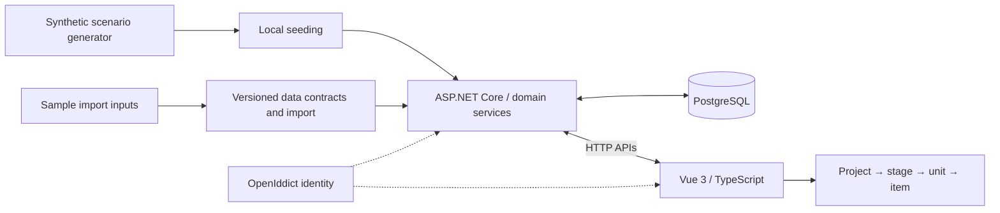

# Architecture

The NPI Factory War Room prototype separates the management interface, business logic and data integration boundary. Its local implementation uses a separate PostgreSQL database and synthetic data to explore project visibility without requiring access to enterprise production systems.

## 1. System overview

The diagram describes the intended component relationships in the local prototype. The current import service supports a subset of the published contracts, and the UI contains predefined demonstration paths. It is not a diagram of an existing enterprise deployment.

## 2. Component responsibilities

| Component | Responsibility | Source |
| --- | --- | --- |
| Browser application | Navigation, stage timeline, settings and import-history screens | [`src/Web`](src/Web/) |
| Application host | HTTP endpoints, local identity configuration, dependency registration and health checks | [`src/Platform.Host/Program.cs`](src/Platform.Host/Program.cs) |
| Domain services | Projects, stage plans, organization/person data, imported records, settings and audit entries | [`src/Core`](src/Core/) |
| Persistence | EF Core entities and PostgreSQL data model | [`NpiDbContext`](src/Core/Data/NpiDbContext.cs) |
| Integration boundary | JSON data contracts and batch import handling | [`contracts/v1`](contracts/v1/) · [`BatchImportService`](src/Core/Import/BatchImportService.cs) |
| Demonstration data | Repeatable synthetic scenario generation and local seeding | [`src/MockData`](src/MockData/) · [`MockDataSeeder`](src/Platform.Host/MockDataSeeder.cs) |

## 3. Navigation and traceability

The example route moves from an overview (L0) to project (L1), stage (L2), responsible unit (L3) and work item (L4). The [Vue views](src/Web/src/views/deep/) and [DeepLinkService](src/Core/Projects/DeepLinkService.cs) illustrate route context and breadcrumb reconstruction. The service uses predefined code-based rules for some stage/unit and item references; these are not a comprehensive deliverable or blocker management engine.

Project and stage entities provide the underlying structure. Import batches, error records and audit entries illustrate separate mechanisms for tracking ingestion and selected application actions. The presence of these mechanisms does not imply that every change is audited.

## 4. Integration and data ownership

The `contracts/v1` directory defines schemas for projects, stage plans, organization units, people, deliverables and blockers. The [current batch import handler](src/Core/Import/BatchImportService.cs) implements handling for organization units, people and projects; the remaining schemas should be read as interface definitions rather than complete import endpoints.

The [synthetic data generator](src/MockData/DvtScenarioGenerator.cs) illustrates additional project scenarios, including deliverables and blockers. Generated examples do not establish persistent CRUD support or a production integration. Connecting a real source system would require agreement on identifier mapping, access permissions, field definitions, ownership and refresh behavior.

## 5. Identity and security design

The host uses OpenIddict for authentication. The project also contains tenant-aware services, department-scope checks, a PostgreSQL row-level security example for `demo_items`, and database-role provisioning logic for staging tables. These are implementation examples, not a claim of comprehensive isolation, enterprise SSO certification or production security readiness.

Relevant code: [department scope](src/Core/Security/DepartmentScopeService.cs), [RLS example](src/Core/Data/DemoItemRls.cs), [tenant session interceptor](src/Core/Data/TenantRlsConnectionInterceptor.cs), [staging database roles](src/Core/Security/TenantDbRoleService.cs).

The [Compose configuration](docker-compose.yml) exposes local development ports on the loopback interface. Any deployment beyond a local workstation requires separate review of identity, network boundaries, credential handling, access control and dependency security.

## 6. Verification scope

The repository includes [backend test sources](tests/) and [frontend unit test sources](src/Web/tests/unit/) for selected areas such as navigation, import handling, settings and tenant isolation. Release-time JSON and Compose configuration checks passed; complete runtime and dependency verification remain pending. See the [README](README.md#verification-and-project-status) for evaluation commands and scope.
